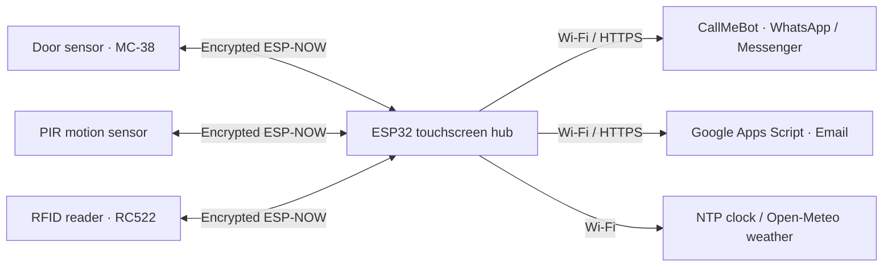

# ESP32 Home Security

**Four custom-built modules. One touchscreen hub. Local control over ESP-NOW.**

A modular residential monitoring project combining embedded software, custom KiCad PCBs, enclosure design, and local manufacturing. Four independent ESP32 firmwares connect a touchscreen hub, magnetic door sensor, PIR motion sensor, and RFID reader.

The hub owns the system state and card authorization. Sensor nodes report observations; the RFID reader requests actions. Internet services add WhatsApp, Messenger, and email notifications without being required for local supervision.

**Project status:** the latest project report documents completed hardware and successful functional integration of the four modules. It reports touch/RFID arming, card management, and notification delivery. These are project-reported hardware results, not automated test results or quantified reliability measurements.

## Highlights

- **Touchscreen control:** English UI on a 3.2-inch ILI9341 display with FT6336 capacitive touch, presented in 320 × 240 landscape.
- **Distributed sensing:** MC-38 door contact and PIR motion detection with filtering and explicit unknown/offline states.
- **RFID management:** hub-side authorization, enrollment, removal, and persistent storage for up to 32 card UIDs.
- **Encrypted local links:** provisioned ESP-NOW unicast peers, per-pair LMKs, application acknowledgements, deduplication, and automatic channel recovery.
- **Remote notifications:** WhatsApp and Messenger through CallMeBot; email through a Google Apps Script web app.
- **Local feedback:** confirmed-state LEDs, recent event history, and a red full-screen event alert with touch dismissal.
- **Clock and weather:** NTP time and Open-Meteo weather, with unavailable and stale-data indicators.

## Architecture



| Module | Responsibility | User feedback |
| --- | --- | --- |
| [Hub](firmware/hub/) | Global state, sensor supervision, card authorization, UI, and network services | Touchscreen and remote notifications |
| [Door](firmware/door/) | Debounce and report the magnetic contact | LED on only when armed and connected |
| [PIR](firmware/pir/) | Sensor warm-up, filtering, and motion reports | LED on only when armed and connected |
| [RFID](firmware/rfid/) | Read card presence and request actions from the hub | Green: disarmed; red: armed; both off without confirmed state |

Nodes do not need to join the router. When the hub is associated with Wi-Fi, ESP-NOW shares its channel. Nodes recover the channel through scanning and validated synchronization. Loss of internet does not itself disable local operation, although Wi-Fi association and channel changes can temporarily interrupt radio traffic.

The shared [application protocol](firmware/common/PROTOCOL.md) defines explicit binary serialization, session/sequence handling, retries, and `STATE_SYNC` acknowledgements. The [RFID contract](firmware/common/RFID_CONTRACT.md) adds short-lived operation contexts and correlated results. An ESP-NOW send callback alone is not proof that the hub processed an action.

## How it behaves

The hub starts **disarmed** after every reboot. Arming requires at least one connected sensor: door or PIR. RFID connectivity does not satisfy that requirement. Disarming does not require an online sensor.

An open door, active motion, or PIR warm-up does not independently block arming. While armed, admitted events can produce notifications and a red visual alert. The controller stays armed: although the protocol defines `ALARM` and `EXIT_DELAY`, the current controller does not transition into those states.

The UI provides **Home**, **Events**, **Nodes**, and **Setup**. Settings include diagnostics, touch testing, access cards, and notification tests. Card enrollment follows **Setup → Access cards → Add card → Scan card** and opens a 30-second enrollment window. Enrollment does not arm the system.

| Parameter | Current configuration / behavior |
| --- | --- |
| Link heartbeat / timeout | 5 seconds / 15 seconds |
| Report retries | Up to 3 transmissions, 250 ms apart |
| Channel search | 1 second per channel; not a total recovery-time guarantee |
| Door debounce | 40 ms |
| PIR setup in the reported build | 30-second warm-up, 10 ms sampling, 50 ms stability filter |
| RFID operation context / card removal | 5-second validity / 500 ms confirmed absence |
| Card storage | Up to 32 UIDs in a versioned, CRC-checked NVS blob |
| Event history | 16 entries in RAM |
| Notification queues | 16 entries per channel, expiring after 10 minutes |
| Visual alert | 10 seconds after drawing completes, or tap to close |

PIR electrical behavior and timing must be configured locally; the public template deliberately leaves unconfirmed settings unset. Queue contents and event history do not survive a reboot. Provider acceptance does not prove message receipt or reading.

## Repository layout

```text
firmware/
├── common/     Shared protocol library, contracts, and tests
├── hub/        Display, touch, state controller, radio, RFID authority, networking
├── door/       Door contact firmware and logic tests
├── pir/        PIR firmware, diagnostics, and tests
└── rfid/       RC522 firmware, diagnostics, and tests
hardware/
├── kicad/      Schematics, PCB layouts, and associated exports
├── hub/        Module manufacturing files
├── door/       Module manufacturing files
├── pir/        Module manufacturing files
└── rfid/       Module manufacturing files
```

Manufacturing assets include LightBurn laser projects and DXF files for CNC preparation. The STEP file alongside the door KiCad project is a **PCB 3D export**, not an enclosure model. The report describes enclosure design and completed assemblies; only files actually present in this repository are distributed here.

## Development environment

The report and inspected local environment identify the following baseline:

| Component | Version / source |
| --- | --- |
| Target | Classic ESP32, Arduino C++ |
| Arduino-ESP32 | 3.3.10 |
| Arduino CLI | 1.5.0 in the inspected environment |
| DomoticaProtocol | 1.2.0, included in `firmware/common` |
| MFRC522 | 1.4.12 |
| Adafruit GFX | 1.12.6 in the inspected environment |
| Adafruit BusIO | 1.17.4 in the inspected environment |
| Hub firmware identifier | `hub-wa-0.6.0` |
| Display / touch | Local SPI display driver and bundled FT6336 driver |

Wi-Fi, ESP-NOW, FreeRTOS, NVS, HTTPS, certificate-bundle support, and cJSON come from the ESP32 environment. The hub uses Adafruit GFX for drawing primitives; it does not use the manufacturer's TFT_eSPI or LVGL demo as its display initialization.

### Configure your own devices

Clone the repository, install the ESP32 board support and listed Arduino libraries, then create local configuration files from the templates:

| Module | Copy this template | To this ignored local file |
| --- | --- | --- |
| Hub Wi-Fi | `firmware/hub/secrets.example.h` | `firmware/hub/secrets.h` |
| Hub radio | `firmware/hub/radio_secrets.example.h` | `firmware/hub/radio_secrets.h` |
| WhatsApp | `firmware/hub/whatsapp_secrets.example.h` | `firmware/hub/whatsapp_secrets.h` |
| Messenger | `firmware/hub/messenger_secrets.example.h` | `firmware/hub/messenger_secrets.h` |
| Email | `firmware/hub/email_secrets.example.h` | `firmware/hub/email_secrets.h` |
| Door | `firmware/door/config.example.h` | `firmware/door/config.local.h` |
| PIR | `firmware/pir/config.example.h` | `firmware/pir/config.local.h` |
| RFID | `firmware/rfid/config.example.h` | `firmware/rfid/config.local.h` |

Provision your own STA MAC addresses, explicit PMK, and unique LMK for each hub/node pair. Matching peers must use compatible keys. Some public node examples retain a project-specific hub MAC: replace it with your own; it is not a discovery default. Verify input polarity, LED polarity, sensor readiness settings, and permitted channels before enabling provisioned operation. Empty or invalid credentials do not enable an unencrypted fallback.

Configure only the notification channels you intend to use. Email requires a separately deployed Google Apps Script endpoint with `HUB_SECRET` and `EMAIL_TO` properties; that deployment is not included in this repository. Keep the matching shared secret in the ignored hub configuration. Never put real Wi-Fi credentials, notification API keys, phone numbers, or radio keys in example files.

### Build and upload

Each module is a separate sketch. From the repository root, supply the shared library explicitly, for example:

```sh
arduino-cli compile --fqbn esp32:esp32:esp32 --library ./firmware/common ./firmware/hub
arduino-cli compile --fqbn esp32:esp32:esp32 --library ./firmware/common ./firmware/door
arduino-cli compile --fqbn esp32:esp32:esp32 --library ./firmware/common ./firmware/pir
arduino-cli compile --fqbn esp32:esp32:esp32 --library ./firmware/common ./firmware/rfid
```

Use the board definition and flash settings appropriate to your ESP32 board. Upload each sketch to its corresponding module using Arduino IDE or Arduino CLI and the actual serial port. The external enclosure USB-C connector supplies power only; the report describes opening the enclosure to reach the ESP32 programming port.

These commands are build instructions, not a claim that a fresh build or hardware test was run for this README. Source-level tests are included under each module's `tests/` directory and under `firmware/common/tests/`.

## Hardware and fabrication

The reported assemblies use four custom single-sided PCBs, separate enclosures, and individual 5 V supplies through two-wire USB-C power connectors. The RC522 operates from 3.3 V. PCB preparation combines KiCad design, laser removal of a paint mask, chemical etching, UV solder mask, and CNC drilling/outline cutting.

The hub's fixed PCB wiring is:

| Interface | GPIO assignments |
| --- | --- |
| LCD | CS 18, RST 19, DC 21, MOSI 22, SCK 23, MISO 33, backlight 32 |
| Touch | SCL 25, RST 26, SDA 27, INT 14 |
| Unused SD select | CS 13, held high |

The LCD runs at 1 MHz SPI; touch uses 100 kHz I2C. Do not replace these assignments with manufacturer demo wiring.

For RFID, the latest report and [current board definitions](firmware/rfid/board_pins.h) agree on SS 17, RST 23, SCK 18, MISO 21, MOSI 19, and IRQ 22, with green/red LEDs on 25/26. These differ from an older project context table (SS 21, RST 22, MISO 19, MOSI 23); the source records an explicit user correction. Confirm the actual board wiring before reproducing the assembly.

## Validation and limitations

The latest project report, *Sistema modular de domótica y seguridad residencial con ESP32*, documents completed assemblies and functional checks of inter-module communication, touch/RFID arming and disarming, card management, WhatsApp/Messenger/email notifications, and visual-alert dismissal. The report is maintained outside the public repository.

The project is an academic monitoring prototype, with these documented limits:

- Touch controls and card administration have no PIN or administrator authentication.
- RFID authorization uses a card UID, which can be copied; it is not cryptographic card authentication.
- The system starts disarmed after reboot and has no battery backup, siren, or physical lock actuator.
- Event history and notification queues are bounded and volatile; remote delivery depends on external services.
- Radio recovery can involve interruptions. No measured range, latency, packet-loss, or power-consumption figures are claimed.
- Touch-panel electrical levels have not been fully characterized across operating conditions.
- No residential alarm, electrical, or environmental certification is claimed.

## What is kept local

The public repository includes firmware, configuration examples, protocol documentation, tests, and hardware/manufacturing sources. `.gitignore` excludes real secrets, local node configuration, build outputs, caches, KiCad internal histories/preferences, `AGENTS.md`, and the root `docs/`, `escuela/`, and `references/` folders.

The original manufacturer package and academic report are not bundled. Removing a file from tracking does not remove it from earlier commits; older context and reference files remain in repository history.

## Third-party notices

Preserve notices in bundled source files and the [font license](firmware/hub/FONT_LICENSE.txt). External dependencies retain their own licenses. No repository-wide license has been declared.
